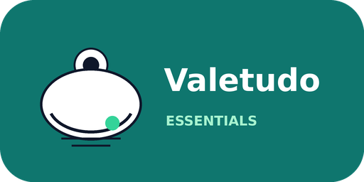

# Valetudo Essentials



Common-sense automations for [Valetudo](https://valetudo.cloud/) robot vacuums in
Home Assistant, delivered as a HACS-compatible custom integration.

Instead of handing you a pile of YAML to copy and maintain, Valetudo Essentials
watches the vacuum entity that Valetudo already publishes over MQTT and runs the
everyday automations most people end up writing anyway. Each automation gets a
switch in Home Assistant, so anything you do not want is one tap away.

## Features

| Automation | What it does | Default |
| --- | --- | --- |
| Clean when away | Starts cleaning after everybody leaves home, after a configurable delay. | On |
| Dock when home | Returns to the dock, pauses, or stops when the first person comes home. | On |
| Quiet hours | Pauses or docks the vacuum during a configurable overnight window. | On, 22:00-07:00 |
| Weekly schedule | Runs on selected weekdays at a selected time. | Off |
| Error notifications | Notifies you when Valetudo reports an error. | On |
| Completion notifications | Notifies you with area and run duration when cleaning finishes. | Off |
| Maintenance reminders | Warns daily when consumables or dock supplies run low. | On |
| Auto-empty | Presses Valetudo's auto-empty dock button after each completed run. | Off |

A few details that make the automations behave sensibly:

- Automated starts only happen when the vacuum is docked or idle and the battery
  is at or above the configured minimum. Battery state is read from the vacuum
  entity or a battery sensor on the same device.
- If everybody leaves during quiet hours, cleaning is queued and starts when
  quiet hours end, provided nobody has come home in the meantime.
- Quiet hours can pause a running vacuum, return it to the dock, or stop it. When
  "resume" is enabled, a vacuum that was paused by quiet hours resumes afterwards.
- Coming home can pause, stop, or dock the vacuum. An intentional interruption
  does not produce a "cleaning finished" notification.
- Consumables are auto-discovered: percentage sensors on the vacuum's device are
  checked daily, excluding battery, Wi-Fi, and signal sensors. You can override
  the list with specific sensors.
- Valetudo exposes fan speed as a `select` entity. Pick it explicitly or let the
  integration discover it, then choose the speed used before automated starts.
- The auto-empty button is discovered from Valetudo's "Trigger Auto Empty Dock"
  button. You can also point the integration at a different button. This is off by
  default because many auto-empty docks already empty themselves after a run.
- If a notification service is not set or is unavailable, a persistent
  notification is created instead. Nothing is silently lost.

## Requirements

- Home Assistant 2025.8 or newer.
- Valetudo connected to Home Assistant through MQTT discovery, so a `vacuum.*`
  entity exists.
- A presence source for the away/home automations. The default is `zone.home`;
  `person`, `device_tracker`, `input_boolean`, and `binary_sensor` entities also
  work.

Valetudo's segment, zone, and go-to commands are intentionally not wrapped here.
Valetudo documents those as `mqtt.publish` actions because the payloads depend on
your map. You can call a script that does that from the "Service to run after
cleaning" option, or from your own automations alongside this integration.

## Installation

### HACS

1. Add this repository as a custom repository of type **Integration** in HACS.
2. Install **Valetudo Essentials**.
3. Restart Home Assistant.
4. Go to **Settings > Devices & services > Add integration** and search for
   **Valetudo Essentials**.

### Manual

Copy `custom_components/valetudo_essentials` into your Home Assistant
`config/custom_components` directory and restart Home Assistant.

## Setup

1. Pick the vacuum entity created by Valetudo's MQTT discovery.
2. Open the integration's **Configure** dialog and fill in the sections you care
   about. General settings cover presence, minimum battery, fan speed, and shared
   notification/post-run services.
3. Use the switches on the **Valetudo Essentials** device to enable or disable
   individual automations. Switch states are stored in the config entry and
   survive restarts.

Each vacuum gets its own config entry. To change the vacuum of an entry, remove
the entry and add it again for the other vacuum.

### Options reference

- **Presence entity**: entity that tells the integration whether somebody is
  home. Zone entities are treated as occupied when their numeric state is greater
  than zero. Unknown and unavailable states do not trigger anything.
- **Minimum battery to start**: automated starts are skipped below this level.
  Unknown battery state does not block a start.
- **Fan entity / fan speed**: optional `select` entity and option applied before
  automated starts. "No change" leaves the current setting alone.
- **Default notification service**: a service such as
  `notify.mobile_app_phone`.
- **Service to run after cleaning**: any service, for example
  `script.after_vacuum`. It is called without a target, so use a script if you
  need to act on entities.
- **Auto-empty button**: leave empty to discover the Valetudo auto-empty button.
- **Away delay**: grace period before starting when the house becomes empty. If
  somebody returns during the delay, the start is cancelled.
- **Home action**: return to the dock, pause, or stop.
- **Quiet hours**: the window, the action, and whether to resume a paused run.
- **Weekly schedule**: weekdays, time, and whether to require an empty house.
- **Notification services**: per-notification overrides for errors and
  completions.
- **Maintenance sensors**: optional explicit list. Leave empty to auto-discover
  percentage sensors on the vacuum's device.
- **Maintenance threshold and time**: the warning threshold and the daily check
  time.

## Entities

The integration creates one service device named **Valetudo Essentials**, linked
to the vacuum's device when the device registry knows about it. On that device
you get one switch per automation:

- `switch.valetudo_essentials_clean_when_away`
- `switch.valetudo_essentials_dock_when_home`
- `switch.valetudo_essentials_quiet_hours`
- `switch.valetudo_essentials_weekly_schedule`
- `switch.valetudo_essentials_error_notifications`
- `switch.valetudo_essentials_completion_notifications`
- `switch.valetudo_essentials_maintenance_reminders`
- `switch.valetudo_essentials_auto_empty_after_cleaning`

Entity IDs depend on your naming; the switches are grouped on the helper device.

## Notes and limitations

- The integration uses standard `vacuum.start`, `vacuum.pause`, `vacuum.stop`,
  and `vacuum.return_to_base` services. It does not depend on a specific Valetudo
  version.
- Cleaning is not started when the vacuum is already running, paused, returning,
  or in an error state. A paused run is only resumed by the quiet-hours feature.
- Home Assistant restarts do not retroactively trigger away/home automations. The
  integration reacts to state changes after it starts.
- Completion notifications use Valetudo's "Current Statistics Area" and "Current
  Statistics Time" sensors when present, and fall back to elapsed time.
- Automatic discovery needs the vacuum entity to be in the entity registry with a
  device. If you use an unusual setup without a device, configure the sensors and
  buttons explicitly.

## Development

The project uses [devbox](https://www.jetify.com/devbox) for tooling and
[uv](https://docs.astral.sh/uv/) for Python dependencies:

```bash
devbox run -- uv sync
devbox run test
devbox run lint
devbox run format
```

The test suite covers the pure decision logic and the config and options flows.

Before publishing, replace the placeholder GitHub username in
`custom_components/valetudo_essentials/manifest.json` and the repository links in
this README and `hacs.json` with your own details.

## License

MIT
